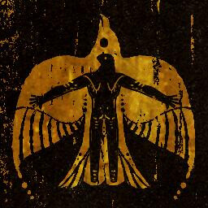

**Haoyu Wang** · Learn, build, revisit.

<a href="https://blueyo0.github.io/rolling-buffer/">Rolling Buffer</a> ·
<a href="https://scholar.google.com/citations?user=mBXk8mYAAAAJ">Scholar</a> ·
<a href="https://github.com/blueyo0">GitHub</a>

---

### About

🖥️ &nbsp; Working on AI compilers and agentic systems. Previously a medical AI researcher (see [SAM-Med3D](https://github.com/uni-medical/SAM-Med3D)).\
🧠 &nbsp; Learning about ML systems, agentic applications and AI-powered healthcare.\
🎮 &nbsp; Off the clock: gaming, slow walks, and time with family.

### Works

**Research**

**Tools**

**Open source**

### 🏆 Achievement Wall

<b>11 / 11</b> games completed · click an icon to visit the game

<table>
<tr>
<td align="center" width="96"> Pokémon Pokopia</td>
<td align="center" width="96"> Hollow Knight: Silksong</td>
<td align="center" width="96"> Sultan's Game</td>
<td align="center" width="96"> Black Myth: Wukong</td>
<td align="center" width="96"> Bear and Wolf</td>
<td align="center" width="96"> Father and Son</td>
</tr>
<tr>
<td align="center" width="96"> Monster Hunter Rise</td>
<td align="center" width="96"> Monster Hunter: World</td>
<td align="center" width="96"> Elden Ring</td>
<td align="center" width="96"> Dark Souls</td>
<td align="center" width="96"> Danganronpa V3</td>
</tr>
</table>

---

又中他人一计

