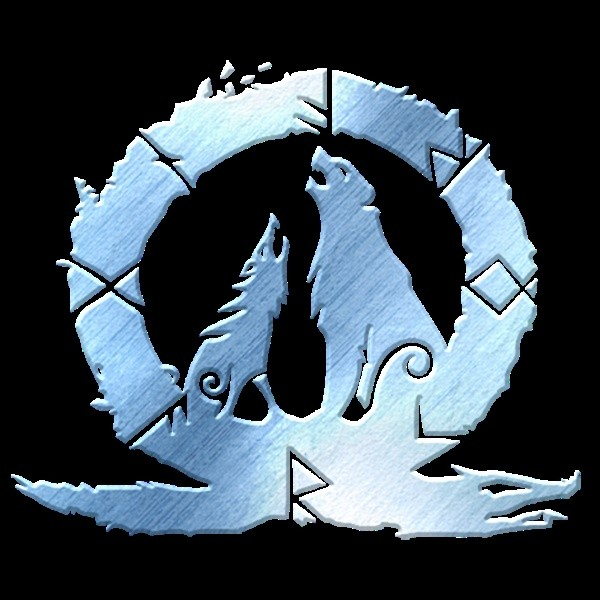

### Hi, I'm Haoyu Wang 👋

`now` &nbsp; AI Infra: compilers & LLM serving\
`was` &nbsp; medical AI researcher, behind SAM-Med3D & STU-Net\
`off` &nbsp; ARPGs, cocktails, family time

### Things I've made

<table>
<tr>
<th width="33%">🔬 Research</th>
<th width="33%">🧰 Tools</th>
<th width="33%">🌍 Open source</th>
</tr>
<tr>
<td valign="top" align="center">
 Promptable segmentation for 3D medical images  
 1.4B-param pre-trained segmentation model
</td>
<td valign="top" align="center">
 One line to load SoTA medical image models  
 Agents that help with bio research
</td>
<td valign="top" align="center">
 Fast LLM serving framework  
 High-throughput LLM inference engine  
 OpenMMLab segmentation toolbox
</td>
</tr>
</table>

 

 

bonfires lit

          

又中他人一计

