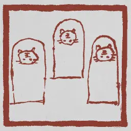

**Haoyu Wang** · AI Infra engineer · CQU → SJTU → Intel → now

### Hi, I'm Haoyu 👋

I work on **AI Infra**: compilers, LLM serving and agentic systems.\
Before that I was a medical-AI researcher, which is where [SAM-Med3D](https://github.com/uni-medical/SAM-Med3D) came from.\
These days I care about making models faster and making AI useful for real people.

📝 Notes live at [Rolling Buffer](https://blueyo0.github.io/rolling-buffer/): learn, build, revisit.

### Things I've made

| | |
|---|---|
| **Research** |   |
| **Tools** |   |
| **Open source** |    |

### Trophy shelf 🎮

Games I've finished. Click one to visit it.

---

又中他人一计 · thanks for stopping by ✌️

