**Haoyu Wang** · writes code by day, rolls through boss fights by night

Hi there 👋

I'm currently poking at **AI compilers** and **agentic systems**, after a detour through Intel
and a past life as a medical-AI researcher (that's where [SAM-Med3D](https://github.com/uni-medical/SAM-Med3D) came from — still proud of that one).

Lately I keep wondering how to make LLMs serve faster, how agents can do real science,
and how AI can actually help doctors instead of just topping benchmarks.

Stuff I've built or helped with:

&nbsp;← research, segment all the 3D things

&nbsp;← tools I wished existed, so I made them

&nbsp;← sent a few PRs, learned a ton

I scribble half-baked notes at 📝 [Rolling Buffer](https://blueyo0.github.io/rolling-buffer/) — learn, build, revisit.

---

When I'm not coding, I'm probably dying to a boss for the 40th time.
Here's my trophy shelf so far (click one to visit the game):

 

又中他人一计 · thanks for stopping by ✌️

