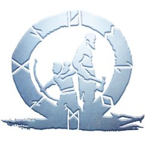
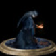

**Haoyu Wang** · Learn, build, revisit.

<a href="https://blueyo0.github.io/rolling-buffer/">Rolling Buffer</a> ·
<a href="https://scholar.google.com/citations?user=mBXk8mYAAAAJ">Scholar</a> ·
<a href="https://github.com/blueyo0">GitHub</a>

---

### About

🖥️ &nbsp; Working on AI compilers and agentic systems. Previously a medical AI researcher (see [SAM-Med3D](https://github.com/uni-medical/SAM-Med3D)).\
🧠 &nbsp; Learning about ML systems, agentic applications and AI-powered healthcare.\
🎮 &nbsp; Off the clock: gaming, slow walks, and time with family.

### Works

**Research**

**Tools**

**Open source**

<b>Game achievements unlocked</b>

 

---

又中他人一计

